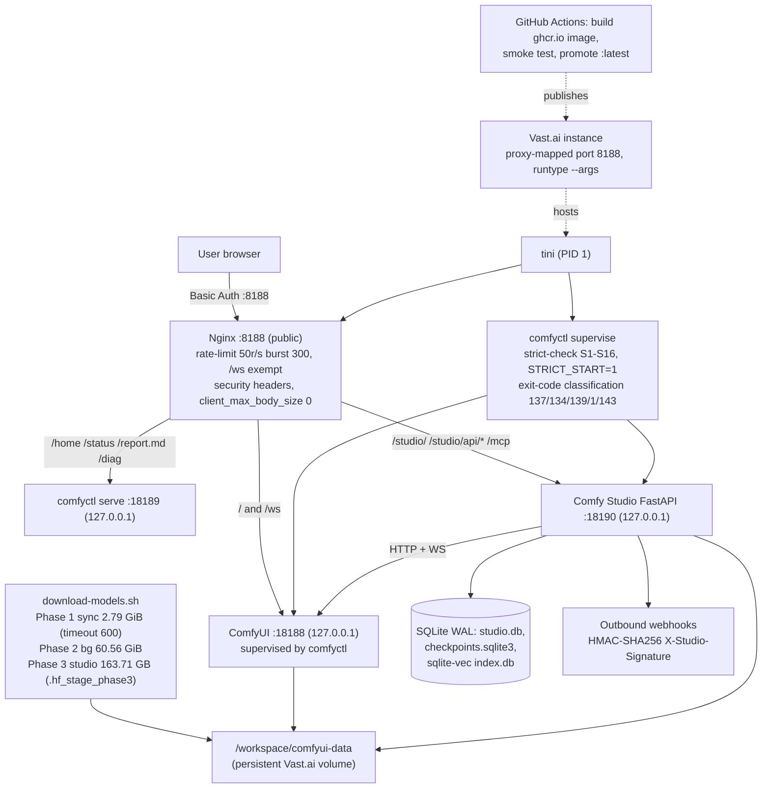

# Canonical Architecture — ComfyUIPod (ComfyUI pod + Comfy Studio on Vast.ai)

**Status:** approved baseline. **Locked assumptions:** single-tenant, ephemeral Vast.ai pod
(RTX 5090 32 GB primary / RTX 4090 24 GB supported), loopback-only internal services,
`MODEL_PROFILE=studio` as reference profile.

This document is the canonical 5-phase architecture. It deliberately **cross-references**
[`docs/decisiones.md`](decisiones.md) (verified research + audit-round decision log V1–V9) and
[`AGENTS.md`](../AGENTS.md) (agent conventions + security rules) instead of duplicating their
prose; where this file and those disagree, `decisiones.md` is the source of truth for *why* and
this file for *what the system is*.

---

## Phase 1: Requirements & Constraints Matrix

| Dimension | Requirement | Enforced by |
|---|---|---|
| Functional | Browser-only ComfyUI (drag `.json`/`.png`, run, no SSH); Basic Auth edge; `/home` portal; `/status` + `/report.md` observability; Comfy Studio (`/studio/`) with projects, assets, 17 templates, perception (keyframes + text∩face vector search), ASR/diarization, SSE agent with 44 tools, durable job recovery, HMAC-signed webhooks, EDL export + deterministic `ffmpeg` render (16:9 / 9:16), creative briefs, assisted montage from brief, review pins, `ad_studio` and an orchestration layer with SQLite checkpoints | `README.md` §1.3, `studio/comfy_studio/app.py` |
| Non-functional | Boot-to-usable ≤ ~10 min worst case (Phase 1 ≤ 600 s, non-fatal); `/ws` exempt from rate limit (50 r/s; burst 300 on `/`, 120 on `/studio/api/`, 60 elsewhere); UI payloads ≤ 40 KB, zero external CDNs; WCAG AA | `config/nginx.conf`, `docs/decisiones.md` (MED-01) |
| Hardware | RTX 5090 (sm_120, CUDA 12.8) primary, RTX 4090 (sm_89) same image; strict gates: driver ≥ 570, VRAM ≥ 20 GB fatal / < 22 GB warn, RAM ≥ 16 GB, disk per profile (210 GB unreal / 180 GB studio / 75 all / 45 general, realistic, anime / 10 minimal / 5 `SKIP_MODEL_DOWNLOAD=1`) | `comfyctl/src/config.rs` (S1–S16), `comfyctl/src/strict.rs` |
| Hard constraints | Single Vast.ai instance, no orchestrator; cost $0.25–0.95/h (5090 interruptible→on-demand); one user; all services bind `127.0.0.1` except nginx `:8188`; secrets never printed/persisted/exposed (see contract table below) | `AGENTS.md` Security Rules 1–6 |
| Compliance | ReActor/InsightFace weights are non-commercial licensed; perception/ASR run in `STUDIO_PERCEPTION_BACKEND=auto`: real backends when the boot probe finds the weights, otherwise deterministic simulations marked `simulated: true` (`docs/propuestas/IDEAS_M3_BACKLOG.md` M3-IDEA-001..005) | `README.md` §1.3 note |

---

## Phase 2: High-Level Architecture & Data Flow

**Lifecycle of a core request (agent-driven render):** browser → nginx `:8188` (Basic Auth,
`.htpasswd`) → Studio `:18190` `/studio/api/*` → agent loop streams SSE → `enqueue_render` →
`comfyui_client.py` POST `/prompt` to ComfyUI `:18188` + track via `/ws` and `/queue`/`/history`
polling → ComfyUI executes on GPU against `/workspace/comfyui-data/models` → job state
persisted in `studio.db` (recoverable via `STUDIO_RESUME_JOBS`) → HMAC-signed webhook fires →
gallery/EDL + `ffmpeg` render.

**Boot sequence:** `tini` → `scripts/start.sh` → `comfyctl strict-check` (on `STRICT_START=1`
failure: keep nginx/portal alive `STRICT_FATAL_GRACE=600s` with red FATAL banner, exit 20 so the
operator runs `comfy destroy`) → `comfyctl diag` (GPU / CUDA matmul / onnxruntime-gpu /
h264_nvenc / libx264, each with hard timeout) → nginx up with `_starting.html` → Phase 1
downloads → supervised ComfyUI start → Phase 2/3 background downloads (`setsid -f`).
See `docs/walkthrough.md` for the file-by-file map.

---

## Phase 3: Architecture Decision Records (ADRs)

Full evidence and audit history in [`docs/decisiones.md`](decisiones.md) (rounds V1–V3, SEC/REL/
CRIT/ALTA/MED/BAJA IDs). Summary:

| Layer | The Pick | Runner-Up | Trade-Off (wins at… / breaks at…) |
|---|---|---|---|
| Compute | Self-built image on `nvidia/cuda:12.8.0-runtime-ubuntu24.04` + pinned `torch 2.9.1+cu128`, GHCR via GH Actions; `tini` PID 1 + `comfyctl supervise` | Official Comfy-Org image; k8s/RunPod | Gains: sm_120 Blackwell support, pinned cu128 terna, runtime C/C++ toolchain for `torch.compile`/custom nodes. Breaks at >1 concurrent user / 24-7 uptime (needs cross-pod queue). |
| Edge/Ingress | Nginx `:8188`, Basic Auth, rate limit, `/ws` exempt, security headers, `client_max_body_size 0`; all else loopback-only | Caddy + TLS; Vast.ai proxy | Gains: boring, `nginx -t`-validated, topology-based security. Sacrifices TLS on direct ports + SSO — fine for single-user ephemeral pod. |
| Data Store | Filesystem-first: `/opt/ComfyUI` (code) vs `/workspace/comfyui-data` (data, persistent volume); SQLite WAL (`studio.db`, `checkpoints.sqlite3`) + `sqlite-vec` `index.db` | Postgres + S3; HF Hub as store | Gains: fastest possible "DB" for 30 GB safetensors, atomic same-fs `rename()` staging, resumable downloads. Breaks at multi-writer / multi-pod scale. |
| Messaging/API | ComfyUI native HTTP+WS (`/prompt`, `/ws`), FastAPI+SSE, MCP on same loopback port, signed webhooks | Redis/RabbitMQ broker | Gains: ComfyUI already owns the execution queue; no extra component to fail. Sacrifices backpressure/fan-out — irrelevant single-pod. |
| Supervisor/Observability | Native Rust `comfyctl`: strict-check S1–S16, exit-code classification, `/run/comfyui-supervisor.json`, status server `:18189`, 17-pattern triage, redacted `/report.md` | Prometheus+Grafana; systemd | Gains: zero runtime deps, pod-specific triage knowledge. Sacrifices long-term metrics — by design, pod is ephemeral and `/report.md` is the debug artifact. |
| Auth/Security | Edge-only Basic Auth + loopback binding + `SecretRedactor` on all public output + SSRF guard on webhooks + `PIP_CONSTRAINT`; `security_level=weak` Manager (safe: ComfyUI loopback-only) | mTLS / OAuth2 proxy; CORS header | Gains: defense-in-depth by network topology, no app-level auth to get wrong. Sacrifices per-route authz and audit trails — acceptable single-user. Rules codified in `AGENTS.md` Security Rules 1–6. |

---

## Phase 4: Bottlenecks, Security & Day-2 Operations

- **SPOFs:** nginx is the only public door (started before Phase 1, pre-validated); one GPU —
  CUDA OOM (exit 137) / native crash (134/139) kills in-flight prompts (supervisor restarts
  ComfyUI; `STUDIO_RESUME_JOBS` reconciles at studio boot only); disk — Phase 3 stages 163.71 GB
  on the same volume, guarded at boot by strict-check disk gates (`comfyctl/src/config.rs`
  `default_min_disk_gb`); Vast.ai spot reclaim — durability only from the `/workspace` volume.
- **Attack vectors & mitigations:** credential leakage → never printed + `SecretRedactor`
  (`studio/comfy_studio/config.py`) + comfyctl `redact.rs` on `/report.md`; SSRF via
  `STUDIO_WEBHOOK_URL` → `validate_webhook_url` rejects loopback/RFC1918/link-local/metadata
  (`webhooks.py:75`); Manager `weak` + runtime pip installs → loopback-only + `PIP_CONSTRAINT`;
  webhook forgery → HMAC-SHA256; `/ws` is the one unthrottled surface (monitored, intentional).
- **Observability:** metrics via `:18189` `/status/api` + `/healthz` (`HEAD /system_stats`);
  logs via panel tabs + `/var/log/download-models.log`; triage via 17 patterns
  (`scripts/triage_patterns.json`); `/diag` self-test; `/report.md` ≤ 400 KB auto-redacted for
  agent-assisted debugging. No OTel — deliberate at this scale.
- **Cost drivers:** GPU time dominates ($0.25–0.95/h ≈ $180–$685/mo if left 24/7) — the real
  lever is failing fast (`STRICT_START` exit 20 + `comfy destroy`) and ephemeral usage; then
  disk (180 GB provisioned); CI/registry minor (BuildKit `buildcache` tag, disk pruning).

---

## Phase 5: Implementation Roadmap

| Milestone | Scope | Exit criteria |
|---|---|---|
| **M1 — MVP** (merged) | Pinned cu128 image → GHCR with smoke test before `:latest`; nginx edge + Basic Auth; Phase 1/2 downloads; `comfyctl` supervise + strict-check; `/home`, `/status`, `/report.md` | CI green on `main`; `STRICT_START=1` boots to working ComfyUI ≤ 10 min; `AGENTS.md` validation suite passes |
| **M2 — Studio core** (in flight, PRs #33/#34) | Agent loop + 44 tools, SSE, SQLite checkpoints + `STUDIO_RESUME_JOBS`, sqlite-vec indexes, HMAC webhooks, EDL + ffmpeg render, semantic shot acceptance → gallery | Every simulated response carries `simulated: true`; kill-and-restart recovery test; webhook signature verified E2E |
| **M3 — Real backends ("Perfect Pod")** | Swap deterministic stubs for CLIP ViT-L/14, faster-whisper/whisperx, FunASR camp++, InsightFace (`IDEAS_M3_BACKLOG.md` M3-IDEA-001..004); opt-in Wan 2.2 Animate via `STUDIO_INCLUDE_ANIMATE=1` | VRAM budget validated on 24 GB (4090) and 32 GB; S13 degrades gracefully when M3 weights absent; quality eval separated from simulated outputs |
| **M4 — Hardening / day-2** | TLS on direct ports or documented acceptance; per-route authz if ever shared; webhook retry policy; structural CI disk fix; optional OTel if multi-pod | Audit rounds re-run clean; cost report shows destroy-on-fatal exercised |

Validation gate for every milestone (from `AGENTS.md`): `ruff check studio panel scripts
config/probes` · `pytest studio/tests -q` · `py_compile config/probes/*.py
scripts/check_models_manifest.py` · `python -m comfy_studio.templates` ·
`check_models_manifest.py --fixture --offline` · `cargo fmt --check` · `cargo clippy
--all-targets -- -D warnings` · `cargo test --locked` · `nginx -t -c config/nginx.conf`.

---

## Variable & Environment Contract

Scope legend: **pod env** = set via Vast.ai `-e` at instance creation; **derived** = computed at
boot by `scripts/start.sh`; **runtime** = read per-request/per-process by `comfy_studio`.
Redaction policy per `AGENTS.md` Security Rule 1 and `SecretRedactor`
(`studio/comfy_studio/config.py`): secret values are **never printed, logged, persisted, or
returned by any public endpoint** — they appear only as `<definida>` / `<no definida>` in
`public_dict()` and are scrubbed from `/report.md` by `comfyctl/src/redact.rs`.

| Variable | Default | Scope | Redaction policy |
|---|---|---|---|
| `STRICT_START` | **on** unless `0`/`false` (`comfyctl/src/config.rs:204`) | pod env → `comfyctl strict-check` | Not a secret; value safe to log |
| `MODEL_PROFILE` | `all` in `comfyctl` (`config.rs:188`); `studio` in `comfy_studio` (`config.py:497`) — **see note below** | pod env → downloads, disk gates, S11–S16, studio flags | Not a secret |
| `SKIP_MODEL_DOWNLOAD` | unset → downloads enabled | pod env → disk gate (5 GB) | Not a secret |
| `COMFY_USER` | `admin` (`scripts/start.sh:241`; also `STUDIO_AUTH_USER` fallback) | pod env → nginx `.htpasswd`, studio edge auth | Username not secret; never logged with password |
| `COMFY_PASS` | unset → 24-hex auto-generated, shown **once** (`start.sh:244-287`), stored 0600 in `/run/comfyui-pass` then `unset` (`start.sh:287`) | pod env (or derived) → nginx Basic Auth + studio edge auth | **Secret**: never printed after first display, never in logs/`/report.md`, masked by `SecretRedactor` |
| `STUDIO_API_TOKEN` | unset → MCP `/mcp` requires edge auth only | pod env → `X-Studio-Token` on `/mcp` (`config/nginx.conf`) | **Secret**: `repr=False`, masked, redacted from logs/reports |
| `STUDIO_WEBHOOK_URL` | unset → webhooks disabled | pod env → outbound notifier | Not a secret, but **validated** anti-SSRF (`webhooks.py:75`: rejects loopback/RFC1918/link-local/169.254.169.254, DNS-resolved) |
| `STUDIO_WEBHOOK_SECRET` | unset → unsigned webhooks (discouraged) | pod env → HMAC-SHA256 `X-Studio-Signature` | **Secret**: `repr=False`, masked, redacted |
| `VAST_API_KEY` | unset | pod env → `comfyctl`/`tools/mac/comfy` instance ops | **Secret**: read from env only, never via CLI flag, redacted everywhere |
| `HF_TOKEN` | unset | pod env → `hf` downloads | **Secret**: env-only, never `--token` on CLI (`decisiones.md` SEC-04) |
| `STUDIO_LLM_KEY` / `STUDIO_LLM_FALLBACK_KEY` | unset → stub LLM or 503 | pod env → agent LLM calls | **Secret**: `repr=False`, masked, redacted; never passed to ML workers (allowlist `ML_ENV_ALLOWLIST`) |
| `STUDIO_RESUME_JOBS` | `true` (`config.py:386`) | pod env → `recovery.py` boot reconciliation | Not a secret |
| `STUDIO_RESUME_DELAY_S` | `30.0` | pod env → recovery start delay | Not a secret |
| `STUDIO_RECOVERY_DRAIN_S` | `10.0` | pod env → shutdown drain | Not a secret |
| `STUDIO_RECONCILE_INTERVAL_S` | `30.0` (0 = off) | pod env → live watchdog reconciling jobs vs ComfyUI `/queue`+`/history` (`recovery.py`, `app.py` lifespan) | Not a secret |
| `COMFY_IDLE_TIMEOUT_S` | `3600` (0 = off) | pod env → `comfyctl` idle watchdog (`comfyctl/src/idle.rs`): ComfyUI queue empty + `jobs_active==0` + no `download-models.sh` running | Not a secret |
| `COMFY_IDLE_ACTION` | `warn` (`stop` = write `/run/comfyui-idle-stop` + `vastai stop instance` if `VAST_INSTANCE_ID` + `VAST_API_KEY` + `vastai` CLI present) | pod env → idle watchdog action | Not a secret; `VAST_API_KEY` itself stays **secret** (env-only, never argv/logs) |
| `VAST_INSTANCE_ID` | unset | pod env → target of `COMFY_IDLE_ACTION=stop` | Not a secret |
| `STUDIO_INCLUDE_ANIMATE` | `false` (opt-in Wan 2.2 Animate 14B int8, +18.41 GB, needs ≥ 250 GB disk) | pod env → Phase 3 manifest | Not a secret |
| `STUDIO_INCLUDE_3D` | `true` iff `MODEL_PROFILE=unreal`, else `false` | pod env → Phase 3 manifest | Not a secret |
| `STUDIO_INCLUDE_MINIMAX` | `false` | pod env → Phase 3 manifest | Not a secret |
| `STUDIO_STUB_LLM` | `false` | pod env → deterministic LLM stub (tests) | Not a secret |
| `STUDIO_REQUIRE_AUTH` | `false`, but effective if `COMFY_PASS` set (`config.py:492-493`) | pod env → studio edge auth (defense-in-depth behind nginx) | Not a secret |
| `STUDIO_SERVER_HOST` / `STUDIO_SERVER_PORT` | `127.0.0.1` / `18190` (host sanitized to loopback) | pod env → studio bind | Not a secret |
| `STUDIO_COMFYUI_URL` | `http://127.0.0.1:18188` | pod env → studio→ComfyUI client | Not a secret |
| `COMFY_DATA_DIR` | `/workspace/comfyui-data` | pod env → all data paths | Not a secret |
| `STUDIO_DATA_DIR` | `${COMFY_DATA_DIR}/studio` | pod env → Studio DB/projects/index | Not a secret |
| `STUDIO_MAX_UPLOAD_BYTES` | `512 MiB` per file | pod env → upload ceiling (nginx allows unlimited; app enforces) | Not a secret |
| `STUDIO_UPLOAD_MAX_TOTAL_MB` | `1024` MB per request | pod env → total multipart ceiling | Not a secret |
| `STUDIO_SSE_HEARTBEAT_SECONDS` | `15.0` | pod env → SSE keepalive | Not a secret |
| `STUDIO_FFMPEG_TIMEOUT_S` / `STUDIO_FFPROBE_TIMEOUT_S` | `60.0` / `20.0` | pod env → subprocess timeouts | Not a secret |
| `STUDIO_ENABLE_MCP` | `true` | pod env → MCP endpoint | Not a secret |
| `STUDIO_ML_PYTHON_BIN` | `python3` (ComfyUI interpreter) | pod env → ML worker subprocess | Not a secret |
| `STUDIO_ML_TIMEOUT_S` | `120.0` (per-subcommand defaults in `ml/__init__.py`) | pod env → worker timeout | Not a secret |
| `STUDIO_PERCEPTION_BACKEND` | `auto` (`auto` \| `real` \| `sim`) | pod env → perception backend selection | Not a secret |
| `STUDIO_ORCH_CHECKPOINT_DIR` | `<data-dir>/orchestration` | pod env → checkpoint DB location | Not a secret |
| `COMFY_HEALTHY_UPTIME` | `600` s | pod env → supervisor restart-counter reset | Not a secret |
| `STRICT_FATAL_GRACE` | `600` s | pod env → fatal-grace window before exit 20 | Not a secret |
| `ENABLE_WEB_TERMINAL` | unset → ttyd off (`:7681` loopback only) | pod env → optional web terminal | Not a secret; requires explicit `COMFY_PASS` to enable |

> **Note — `MODEL_PROFILE` default divergence:** `comfyctl` defaults to `all`
> (`comfyctl/src/config.rs:188`) while `comfy_studio` defaults to `studio`
> (`studio/comfy_studio/config.py:360`). In practice the pod env sets it explicitly on Vast.ai;
> if unset, downloads and studio disagree. Candidate for a Part 2 fix (single default, documented).
