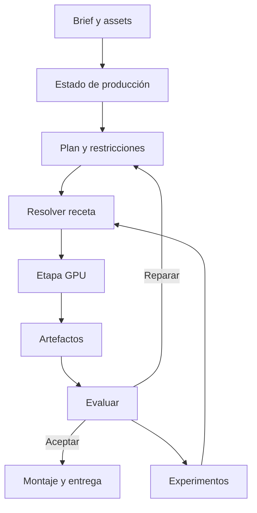

# Marco de investigación avanzada del laboratorio audiovisual ComfyUIPod

Fecha de revisión: 4 de noviembre de 2026. Ampliación v2: programas de investigación y opciones adicionales. Perfil principal propuesto: una NVIDIA RTX PRO 6000 Blackwell de 96 GB de VRAM y 128–256 GB de RAM. Uso individual y de investigación. Entregable principal: reels y videos cortos en 2D, con exportación final 4K.

Este documento propone capacidades y una arquitectura para implementarlas después. Las herramientas mencionadas tienen evidencias públicas de las funciones descritas, salvo las excepciones identificadas. Su integración conjunta, sus tiempos y su calidad en este pod todavía requieren validación. No se alquiló hardware ni se ejecutaron pruebas GPU para esta investigación.

## 1. Qué permite cambiar este perfil

El laboratorio puede planificar procesos exigentes sin imponer 32 GB como condición para aceptar cada nueva capacidad. Se admite cuantización, descarga de componentes completos a RAM y procesamiento por planos. El generador activo debe permanecer completo en VRAM cuando la receta lo permita; la descarga continua de capas queda como alternativa para casos concretos.

La evidencia de referencia es más útil que sumar tamaños de archivos. La matriz actual de Cosmos-Framework documenta Cosmos3-Super FP8 con descarga por modelo en una GPU, con umbrales de 64 GiB de VRAM y 80 GiB de RAM para generación. Otras versiones y recetas de despliegue publican requisitos de RAM diferentes. Por ello se fijarán juntos modelo, runtime, revisión y receta; 128 y 256 GB serán perfiles distintos, no ofertas equivalentes [S01].

Con 256 GB se dispone de más espacio para carga inicial, componentes descargados, índices, geometría y operaciones de medios. Eso no autoriza a mantener varios generadores grandes residentes por defecto. Con 128 GB el planificador deberá admitir únicamente las recetas cuyo pico total de RAM haya sido comprobado.

La principal oportunidad es combinar percepción, reconstrucción, simulación, generación y edición. Una escena 3D o 4D sirve para producir mejores planos 2D, conservar continuidad y explorar alternativas. El agente elegirá el grado de reconstrucción necesario para cada plano.

## 2. Condiciones del laboratorio

| Decisión | Marco propuesto |
| --- | --- |
| GPU principal | Una RTX PRO 6000 Blackwell de 96 GB; validar compilaciones y kernels para esta arquitectura. |
| RAM | Dos perfiles: 128 GB y 256 GB; admisión según memoria realmente disponible y límites del contenedor. |
| Ejecución | Un trabajo GPU pesado a la vez; tareas CPU concurrentes dentro de límites medidos. |
| Precisión | Elegir BF16, FP8 o INT4 según calidad y memoria de la receta; cuantizar no debe equivaler a perder identidad o texto. |
| Resolución de trabajo | Proxies y generación HD/FHD cuando convenga; acabado y exportación 4K. |
| Duración | Generación por planos o ventanas con continuidad explícita, seguida de montaje. |
| Instalación | Motores, dependencias, binarios y adaptadores preparados durante la construcción de la imagen. |
| Pesos | Descarga bajo demanda, por revisión y componentes necesarios, con verificación de integridad. |
| Disco | Sin techo artificial de 180/200 GB; presupuestar imagen, pesos elegidos, temporales y resultados. |
| Distribución | El mismo repositorio y la misma imagen de producción en GHCR. |
| Operación | Interfaz y terminal compatibles con macOS, Windows y Linux; cómputo GPU en Linux. |
| Modelos de lenguaje | Proveedores intercambiables mediante API y alternativa local cuando sea útil. |
| Costes | Motores locales y fuentes gratuitas; el alquiler y las API opcionales tienen presupuesto separado. |
| Secretos | Inyectados al ejecutar; ausentes del código, capas, logs y resultados públicos. |
| Persistencia | Código y biblioteca pública base en main/imagen; proyectos, pesos elegidos y medios personales en almacenamiento de trabajo persistente. |

La biblioteca geográfica pública del Aburrá debe seguir incluida físicamente en la imagen. Una carpeta generada en el sandbox del worker o una caché de un pod no sustituye ese entregable. Los proyectos privados y los modelos descargados durante el uso tienen un ciclo de persistencia distinto y nunca se incorporan automáticamente a una imagen pública.

## 3. Base actual del repositorio

Se revisó main en el commit 0a0df8ee0ebec7b319e9c340345f27cfec25f664 [R01]. El registro declara 16 motores. Existen módulos para ComfyUI, Blender, edición, composición, audio, voz, música, captura 3D, roto, QA y anuncios. También hay percepción, dirección creativa, planificación, ejecución y checkpoints.

Eso permite ampliar estructuras existentes. El campo wired del registro es una declaración de integración y no acredita un render satisfactorio en esta GPU. Hay notas que todavía mencionan adaptadores pendientes, entornos de ejecución o dependencias no preparadas. La nueva arquitectura necesita una descripción de disponibilidad más precisa.

Los puntos de integración a inspeccionar al implementar son:

| Área existente | Función dentro del nuevo marco |
| --- | --- |
| engines/registry.py | Descubrir motores y consultar disponibilidad comprobada por receta. |
| orchestration/state.py y checkpointer.py | Guardar misión, planos, resultados intermedios y decisiones. |
| orchestration/planner.py y adapters.py | Resolver capacidades y construir planes a partir del contexto completo. |
| perception/ | Buscar assets por contenido y recuperar evidencia visual o temporal. |
| creative/ | Brief, propósito, dirección, estilo y criterios de entrega. |
| review_pins.py | Convertir errores localizados en operaciones de reparación. |
| agent_brain/ | Memoria de hechos, recuperación y compresión, sin confundirlas con aprendizaje de pesos. |
| Dockerfile y publicación GHCR | Preparación reproducible y entrega de las capacidades implementadas. |

Esta revisión sirve para fijar el punto de partida. No representa una auditoría completa del comportamiento ni una ejecución de los motores.

## 4. La representación compartida de una producción

Cada misión debe conservar una descripción editable del proyecto: qué pretende comunicar, qué assets existen, qué muestran, qué partes son verificables y qué restricciones deben mantenerse.

La representación debería incluir:

- Assets originales, hashes, procedencia, derechos de uso y fecha de captura cuando se conozca.
- Transcripción, texto visible, personas y objetos, eventos y tramos aprovechables.
- Identidades estables de personajes, productos, vehículos y lugares.
- Cámaras con intrínsecos, posición, orientación, convención de coordenadas y confianza.
- Geometría, profundidad, máscaras, seguimiento y cobertura observada.
- Acciones con tiempo, trayectoria, contacto y relación entre objetos.
- Luces, materiales, condiciones ambientales y decisiones de color.
- Música, diálogos, efectos y ambientes en pistas separadas.
- Timeline con fuentes, cortes, transiciones y composiciones.
- Versiones de recetas, semillas, modelo, precisión y parámetros.
- Evaluaciones y cambios, vinculados al artefacto exacto que produjeron.

OpenUSD puede representar las escenas; OpenTimelineIO puede representar el montaje. Ninguno describe por sí solo toda la intención del agente ni garantiza compatibilidad perfecta entre aplicaciones. Se necesita un contrato del estudio que conecte estas piezas [S27–S29].

El tiempo debe tener una base racional explícita y los adaptadores deben convertir FPS, unidades, ejes, orientación y espacios de color. Muchos microfallos aparecen en esas conversiones.

## 5. Catálogo de 34 capacidades

Las capacidades siguientes son propuestas del laboratorio. Las herramientas citadas aportan piezas concretas; su combinación y las funciones de autonomía requieren desarrollo propio.

### A. Entender los medios y producir una dirección

**C01. Investigar una carpeta como un archivo audiovisual.** El agente recibe de uno a cien assets, agrupa duplicados y tomas relacionadas, transcribe, identifica eventos y produce un mapa temporal consultable. Qwen3-VL aporta comprensión visual y de video; Whisper y la percepción existente completan la indexación [S20]. El resultado debe apuntar a segundos y archivos reales, no limitarse a descripciones generales.

**C02. Convertir una referencia en una receta editable.** Descomponer ritmo, tipos de plano, composición, transiciones, movimiento y sonido. Generar una receta equivalente adaptada a los assets propios. HyperFrames publica herramientas para reconstruir videos como proyectos editables; podemos aprovechar ese trabajo, manteniendo explícito qué decisiones se infirieron [S26]. No se recupera mágicamente el proyecto original del autor.

**C03. Dirigir a partir de evidencia incompleta.** Si el brief es ambiguo, inferir una hipótesis de propósito, público y emoción a partir del audio, productos, evento y contexto. Mantener varias interpretaciones con su evidencia y seleccionar una que pueda ejecutarse dentro de la misión. La incertidumbre debe cambiar las decisiones: un dato comercial dudoso se omite o se conserva como hipótesis, sin inventarlo.

**C04. Biblioteca de lenguaje audiovisual propio.** Guardar recursos narrativos y recetas que funcionaron: revelaciones, anticipaciones, silencios, remates, contrastes de escala, match cuts y cierres en bucle. Recuperarlos por objetivo y compatibilidad con los assets. Es memoria estructurada de decisiones; la personalización de pesos es una capacidad posterior.

### B. Lugares, cámaras y escenarios

**C05. Director de fotografía con trayectorias explícitas.** Usar profundidad y cámaras para proponer dolly, órbita, seguimiento, grúa o acercamientos que respeten los sujetos. WorldForge V2 publica código, pesos y una ruta con GPU de 80 GB basada en MiniMax-H3 y una LoRA de trayectoria [S02]. El perfil de 96 GB es un candidato razonable, pendiente de adaptar y medir.

**C06. Escenarios explorables con memoria espacial.** Generar sucesivos tramos y regresar a un lugar conservando referencias. AlayaWorld aporta memoria espacial e historial; WorldCrafter ofrece una alternativa con memoria consultable por cámara [S03–S04]. La ruta documentada de la demo de WorldCrafter se validó en H200: su funcionamiento en 96 GB permanece experimental.

**C07. Reconstrucción de lugares reales del Aburrá.** Alinear referencias de fachadas, puentes, parques y calles con el atlas incluido. Depth Anything 3 y ViPE aportan geometría y cámaras [S05–S06]. Priorizar reconstrucción multivista y rutas dentro de cobertura observada. Una vista generada sin evidencia suficiente no debe convertirse en la nueva referencia factual del lugar.

**C08. Ensayo virtual de rodaje.** Antes de generar el plano caro, producir un animatic con posiciones, focal, trayectoria, duración y siluetas. Buscar rutas que mantengan el producto legible y eviten obstáculos. Usar Blender como base; cambiar a síntesis neuronal solo para los planos donde aporte una mejora. La función exige integrar colisiones, visibilidad y composición.

### C. Objetos, personajes y movimiento

**C09. Convertir un producto en un activo 3D reutilizable.** SAM 3D Objects permite inferir objetos; TRELLIS.2 ofrece geometría y materiales PBR; Hunyuan3D-2.1 es otra alternativa [S07–S09]. Elegir una ruta principal mediante pruebas de fidelidad. Las caras ocultas inferidas necesitan referencias adicionales si la forma exacta es relevante.

**C10. Desarmar y volver a ensamblar objetos.** PartCrafter genera geometría por partes [S10]. La integración permitiría despieces, ensamblajes, movimientos de componentes y transiciones de producto. La segmentación generativa no prueba cómo está construido un objeto real: un despiece técnico necesita piezas verificadas o un modelo CAD adecuado.

**C11. Rigging automático de activos.** SkinTokens/TokenRig publica un flujo de malla a esqueleto y pesos de deformación [S11]. Permitiría animar mascotas, personajes o modelos generados sin rehacer el rig manualmente. Validar deformaciones y exportación. UniRig es alternativa, con componentes de su hoja de ruta todavía pendientes.

**C12. Biblioteca de movimiento humano recuperado.** Extraer movimiento de videos autorizados y convertirlo en una animación reutilizable. SAM 3D Body recupera cuerpo, manos y pies en una imagen; GVHMR aborda movimiento global desde video [S12–S13]. Sus representaciones no son intercambiables sin conversión; retargeting, escala y contactos requieren validación.

**C13. Inventar coreografías y actuaciones en 3D.** HY-Motion 1.0 genera movimiento desde texto [S14]. Nuestra integración podría componer una actuación, corregir apoyo de pies, adaptarla al personaje y ajustar sus momentos al ritmo del reel. No asumir que una instrucción compleja produce una coreografía satisfactoria en el primer intento.

**C14. Transferir una actuación a los assets entregados.** Wan2.2-Animate aporta animación y sustitución de personajes a partir de una referencia [S15]. La misión elige referencias compatibles con identidad, encuadre y propósito. Un baile humano y el recorrido de un vehículo requieren controles distintos.

**C15. Dirigir movimiento de objetos con precisión.** Wan-Move aporta control mediante trayectorias de puntos [S16]. La propuesta combina trayectorias obtenidas de referencias o simulación con máscaras y profundidad. Se deben medir errores de trayectoria y continuidad: seguir puntos no garantiza por sí solo un comportamiento físico correcto.

**C16. Actores que hablan, cantan y dialogan.** InfiniteTalk ofrece animación guiada por audio; su proyecto señala también LongCat-Video-Avatar como línea posterior [S17]. Integrar pista por hablante, identidad, turnos, planos de escucha y sincronía. Un avatar persistente incluye referencias, voz y restricciones, sin prometer continuidad perfecta solo por repetir un prompt.

### D. Escenas físicas y nuevas formas de rodar

**C17. De un MP4 a una escena 4D editable.** OVOW publica un pipeline de video monocular a escenas de mallas con objetos y movimiento [S18]. Podemos investigar retiming, nuevas cámaras y edición de relaciones espaciales. Su recomendación de 40 GB o más hace interesante el perfil de 96 GB; la fidelidad y los picos reales siguen pendientes.

**C18. Coordinador de acciones y colisiones.** Simular antes de renderizar una acción: un objeto cae, un vehículo frena o una cámara acompaña una trayectoria. Blender y Newton aportan piezas; Newton está orientado a simulación y ofrece integración USD [S19]. El controlador audiovisual y las reglas de cada escena son desarrollo propio.

**C19. Efectos con materiales que interactúan.** Lluvia, telas, partículas, arena, espuma o deformaciones pueden producir guías y pases para composición. Empezar con funciones de Blender; evaluar Newton o Genesis World para un efecto que justifique otro motor [S19, S30]. La existencia de un solver no implica un preset cinematográfico terminado.

**C20. Optimizar la puesta en escena.** Buscar focal, cámara, posición y tiempo de una acción para satisfacer restricciones: producto visible, ausencia de intersecciones, composición y duración. Usar evaluación numérica y, cuando proceda, optimización diferenciable del simulador. Es una línea de investigación propuesta, con variables y criterios verificables; no exige reentrenar un modelo fundacional.

### E. Volver a iluminar, transformar y reparar

**C21. Reiluminar después de grabar.** DiffusionRenderer estima propiedades visuales y permite síntesis guiada por iluminación; Light-X combina control de cámara y luz [S21–S22]. Investigar cambios de hora, luz de estudio y materiales. Mantener geometría, matrículas y logos mediante composición o validación donde sea necesario.

**C22. Grabar una vez y cambiar el mundo alrededor.** ID-V2V utiliza video y fotogramas estilizados para reestilizar la escena conservando la actuación como referencia [S23]. Permitiría realizar una interpretación sencilla y explorar varios tratamientos. La fidelidad publicada es un objetivo a medir, no una garantía para cada rostro o gesto.

**C23. Generación audiovisual con referencias múltiples.** Incorporar una familia principal para texto, imagen, video y audio según la tarea: LTX-2.5, MiniMax-H3 o Wan [S24–S25, S15]. El agente selecciona y resume los assets relevantes. Las cien entradas de un proyecto no se introducen simultáneamente en un modelo con un límite mucho menor.

**C24. Reparación localizada y continuidad entre planos.** Usar VACE para ediciones espaciales con máscaras y LTX Retake para ventanas temporales [S31, S24b]. Traducir una observación de QA en región y tiempo. Reensamblar las partes aprobadas desde su fuente para conservarlas realmente; comprobar que el arreglo no genera otra regresión.

### F. Sonido, música y voz

**C25. Diseñador de sonido que entiende la escena.** SAM-Audio aísla sonidos mediante texto, tiempo o evidencia visual; MMAudio sintetiza audio relacionado con video [S32–S33]. Nuestra integración organiza pistas y eventos compartidos con la imagen, y puede aplicar acústica con Steam Audio [S34]. Así puede construir ambientes y transiciones con causas y tiempos coherentes.

**C26. Compositor de música original orientada al montaje.** ACE-Step 1.5, incluido XL, aporta generación y herramientas musicales [S35]. La propuesta añade planificación de entrada, tensión, golpe, pausa y final en bucle. Conservar BPM, tonalidad, versiones y stems cuando estén disponibles; no dar por hecho que toda generación separa instrumentos limpiamente.

**C27. Dirección de voz en español.** Qwen3-TTS ofrece español y control de voz; se compararía con IndexTTS existente [S36]. El laboratorio debería medir pronunciación colombiana, nombres de lugares, cifras, intención y pausas. El soporte del idioma no acredita automáticamente acento paisa. Guardar un diccionario de pronunciación y variantes aprobadas.

### G. Acabado y entregables editables

**C28. Fotogramas de dirección y elementos con transparencia.** Qwen-Image-2.1 publica generación y edición, hasta diez referencias y salida RGBA; Turbo ofrece una ruta de ocho pasos [S44]. Permitiría crear keyframes y capas antes de animarlos. Su licencia es de investigación. FLUX.2 aporta alternativas con referencias múltiples, con licencias diferentes según variante [S47]. Comprobar el modelo local; las API comerciales no son necesarias para esta capacidad.

**C29. Matting para composición exigente.** Integrar seguimiento del sujeto con un matte suave que preserve pelo, desenfoque y transparencias donde el material lo permita. VideoMaMa original tiene código y checkpoints publicados [S45]. CorridorKey es una referencia técnica interesante, pero sus términos restringen el reempaquetado y la integración en productos competidores; su inclusión en la imagen pública no se da por autorizada [S46]. VideoMaMa++ sigue sin entrega completa de código y pesos y queda fuera de la ruta implementable actual [S45b].

**C30. Restauración temporal y exposición.** FlashVSR+ y SeedVR2 son candidatos para acabado; DiffHDR aporta investigación de reexposición [S37–S39]. Proteger texto, rostros, arquitectura y detalles del producto. La mejora generativa puede inventar detalle; una imagen más nítida no prueba mayor fidelidad factual.

**C31. Efectos programables y versiones de montaje.** HyperFrames, Remotion, Blender y el compositor existente pueden producir títulos, gráficos y transiciones [S26, S40]. El agente crea presets parametrizados y reutilizables, con límites de duración y memoria. Remotion tiene licencia propia y condiciones para redistribución; HyperFrames declara Apache-2.0.

**C32. Entrega adaptada y reproducible.** Exportar máster 4K, versiones de relación de aspecto, subtítulos, pistas y proyecto editable cuando el formato lo permita. Comprobar safe areas, sincronía, color y legibilidad. El reencuadre se decide por contenido; ampliar un fondo de un lugar real necesita mantener la regla de cobertura y evidencia.

### H. Un laboratorio que acumula conocimiento

**C33. Investigador de recetas y preferencias.** Comparar modelos, precisiones, pasos, controles y estrategias con assets y tareas fijos. Optuna aporta optimización de varios objetivos; VideoReward ofrece señales de calidad visual, movimiento y alineación textual [S41–S42]. Conservar la frontera entre calidad, coste y tiempo. El gusto personal requiere evidencia propia; esos jueces no predicen viralidad.

**C34. Aprendizaje y ampliación de capacidades.** Entrenar LoRA de estilo, identidad o música cuando el caso y la licencia lo permitan, usando conjuntos de validación separados. Generar nuevos efectos o adaptadores en un entorno de desarrollo, convertirlos en cambios revisables y publicarlos por la vía del repo. La instalación de motores continúa ocurriendo antes del despliegue; el agente de producción utiliza lo preparado.

## 6. Evidencia de hardware y disponibilidad

Las cifras siguientes son requisitos o resultados publicados por sus autores, no mediciones de ComfyUIPod. No deben sumarse ni extrapolarse a cualquier duración y resolución. Se conserva la unidad GB/GiB utilizada por la fuente.

| Herramienta | Evidencia publicada pertinente | Lectura para este laboratorio |
| --- | --- | --- |
| Cosmos3-Super | FP8 con descarga por modelo: 64 GiB VRAM y 80 GiB RAM en la matriz de Cosmos-Framework [S01]. | Candidato a generador residente por etapa; fijar versión del runtime y límites de video. |
| WorldForge V2 | Ruta con una GPU de 80 GB [S02]. | Candidato prioritario de control de cámara; falta comprobar Blackwell y calidad. |
| SAM 3D Objects | Instalación indica GPU de al menos 32 GB [S07b]. | Reconstrucción de objetos dentro del alcance previsto; no implica exactitud de caras ocultas. |
| TRELLIS.2 | Documenta al menos 24 GB y pruebas en A100/H100 [S08]. | Evaluar picos por resolución y objeto; no usar 24 GB como techo. |
| Hunyuan3D-2.1 | 10 GB forma, 21 GB textura y 29 GB conjunto según README [S09]. | Alternativa de objeto y material, sin mantener otro generador grande residente. |
| PartCrafter | Mínimo publicado de 8 GB; número de partes y tokens cambian memoria [S10]. | Interesa por descomposición, sujeto a verificar utilidad de cada parte. |
| SkinTokens | Mínimo publicado de 14 GB [S11]. | Candidato de rigging automático con código y checkpoints publicados. |
| HY-Motion 1.0 | 26 GB en condiciones reducidas; excluye el módulo LLM de reescritura [S14]. | El generador y el reescritor se contabilizan por separado. |
| Wan-Move | Ruta documentada en una GPU de 40 GB con descarga de modelos [S16]. | Candidato de control de trayectorias; medir retención completa del generador en 96 GB. |
| OVOW | Recomienda al menos 40 GB, unos 120 GB de disco y unos 55 GB de pesos [S18]. | Experimental; varias dependencias y licencias de investigación. |
| DiffusionRenderer | Ruta académica con optimizaciones para RTX 4090 de 24 GB [S21]. | La validación inicial debe respetar las condiciones de clip publicadas. |
| ID-V2V | Ruta de una GPU con descarga a CPU y descarga de componentes de unos 96 GB de disco [S23]. | El tamaño de descarga no es una medición de VRAM. |
| FlashVSR+ | Publica inferencia 4K en RTX 4090 de 24 GB [S37]. | Candidato fuerte para acabado temporal; revisar compatibilidad del backend. |
| ACE-Step 1.5 XL | Publica al menos 12 GB con offload; recomienda al menos 20 GB [S35]. | Familia musical razonable para el perfil; elegir variante con pruebas de escucha. |
| WorldCrafter | Demo validada en una y dos H200 [S04b]. | Disponibilidad pública comprobada; ajuste a 96 GB sin demostrar. |
| AlayaWorld | Código y pesos; varias rutas y dependencias [S03]. | Investigación experimental, sin prometer aquí un pico o rendimiento en 96 GB. |
| Qwen-Image-2.1 | Modelo visual de 7B, checkpoints base/Turbo y soporte de cuantización publicado [S44]. | Candidato a keyframes y capas; medir pipeline completo, incluido el encoder. |
| Light-X | Código, checkpoints e instrucciones de inferencia publicados [S22]. | Interesante para cámara y luz; sin medición de este pod. |
| DiffHDR | Experimentos de autores en A100 de 80 GB [S39]. | Candidato de investigación; adaptar dependencias antiguas si hace falta. |

La cuantización por archivo tampoco garantiza que todas las operaciones permanezcan a esa precisión. Las activaciones, caches, módulos auxiliares y buffers necesitan memoria. El runtime debe medir el proceso completo.

## 7. Cómo operar con una GPU

El planificador asigna una reserva de GPU a un trabajo. Antes de comenzar registra RAM y VRAM disponibles, receta elegida y presupuesto restante. Prepara únicamente los pesos necesarios y devuelve recursos al acabar. Los módulos pequeños pueden coexistir cuando esa combinación haya sido validada.

Al cambiar de etapa, guardar resultados en disco con identidad y metadatos suficientes para continuar. Las máscaras, cámaras, profundidad y audio no deben perderse al descargar un modelo. El proceso siguiente trabaja sobre esos artefactos.

Preferencia de ejecución:

1. Precisión de mejor calidad que quepa con margen medido.
2. Cuantización validada, conservando el generador activo.
3. Descarga de componentes completos y ejecución por fases.
4. Ajustes de batch, duración o resolución compatibles con el objetivo.
5. Descarga por capas para una receta que la necesite y cuyo tiempo sea aceptable.
6. Alternativa de motor cuando ofrezca mejor resultado dentro del presupuesto.

No se debe degradar silenciosamente un máster, cambiar un lugar reconocible o perder identidad para evitar un error de memoria. Esas restricciones pertenecen a la misión.

La RAM es un recurso global. Cargar modelos en paralelo, copiar checkpoints a memoria compartida y mantener fotogramas decodificados puede agotar 128 GB aunque cada motor aislado funcione. La selección de ofertas también debe considerar CPU, almacenamiento, límites efectivos y velocidad de transferencia; no basta con el nombre de la GPU.

## 8. Autonomía con una misión persistente

El agente recibe una misión que incluye objetivo, assets, público, referencias locales, duración orientativa, libertad creativa y presupuesto acumulado. De esa misión derivan decisiones y trabajos.

Puede buscar inspiración mediante conectores preparados, separar patrones útiles de cifras de popularidad y seleccionar referencias cuyo contenido pueda obtener y utilizar. Un conector puede descubrir un video sin permitir descargarlo o reutilizar su audio. El plan debe distinguir esas capacidades y recurrir a otra fuente cuando haga falta.

La producción continúa mediante checkpoints durables. Un límite de iteraciones de conversación no debería borrar ni reiniciar el trabajo. La persistencia de LangGraph puede apoyar esta función; los efectos externos y el manejo de artefactos siguen necesitando idempotencia propia [S43].

El agente puede proponer variantes, evaluarlas, reparar y entregar sin nuevas preguntas rutinarias dentro de su mandato. El presupuesto debe acompañar la misión a través de cada continuación. Se registra si una decisión fue tomada por política o por el usuario.

El planificador y el evaluador deben poder usar proveedores distintos. Si ambos son locales, sus turnos GPU se programan igual que los demás motores; no se mantiene un VLM grande compitiendo con la generación por accidente.

## 9. Qué conocimiento debe acumular

Cada ejecución debe producir un registro comparable:

| Campo | Utilidad |
| --- | --- |
| Modelo y revisión | Identificar exactamente qué pesos se usaron. |
| Runtime y backend | Reproducir el comportamiento y diagnosticar incompatibilidades. |
| Precisión y offload | Comparar calidad y coste de memoria. |
| Resolución, frames, FPS y batch | Evitar extrapolaciones engañosas. |
| Pico VRAM y pico RAM | Admitir futuros trabajos con evidencia. |
| Carga, primera generación y repetición | Distinguir arranque de rendimiento sostenido. |
| Descarga, compilación y transferencia | Medir costes que también consumen alquiler. |
| Resultado, fallos y reintentos | Estimar coste por plano válido. |
| Identidad, trayectoria, texto y sincronía | Medir cumplimiento del propósito. |
| Preferencia y procedencia | Diferenciar observación humana, juez y regla automática. |

La frontera de Pareto debería comparar calidad, tiempo total y coste por entregable aceptado. Los resultados deben conservar las dimensiones originales: una puntuación única puede ocultar que una variante es bonita pero cambia el producto o el lugar.

La investigación puede explorar primero proxies y elevar la calidad de candidatos prometedores, comprobando después que la clasificación se mantiene al cambiar de resolución.

## 10. Cómo se considera terminada una integración

Una capacidad necesita evidencias independientes:

1. El proyecto externo tiene código y los componentes necesarios disponibles.
2. Su licencia permite el uso previsto y la distribución de cada parte que se vaya a incluir.
3. El motor arranca con dependencias preparadas en una imagen limpia.
4. El agente puede descubrirlo, prepararlo y ejecutarlo por el contrato del estudio.
5. La receta GPU produce artefactos reales y válidos en el hardware objetivo.
6. La calidad satisface el caso de uso y las restricciones.
7. Reinicio, descarga de modelos y reanudación no rompen la producción.

Una respuesta HTTP saludable, la presencia de un binario y un archivo de salida vacío no cumplen los puntos 5 y 6.

El registro debería exponer por separado instalado, integrado, pesos disponibles, hardware compatible, receta ejecutada y calidad evaluada. El estado experimental es útil siempre que el agente pueda interpretarlo y escoger otra ruta.

## 11. Empaquetado y licencias que afectan decisiones reales

Una sola imagen puede contener entornos aislados por motor. No es necesario imponer una única combinación de Python/PyTorch a todo el laboratorio. El arranque normal no debe instalar motores ni resolver versiones nuevas.

Se construyen wheels, se fijan versiones y se preparan extensiones compatibles con la GPU objetivo. Se evita descargar repositorios completos de pesos cuando una receta utiliza solo un subconjunto. Una descarga interrumpida se reanuda y se verifica antes de hacerla visible.

Hay licencias distintas: código abierto, pesos con licencia propia y componentes de investigación no comercial. OVOW, DiffusionRenderer, SAM y algunos modelos corporales requieren tratamiento por componente. El carácter no comercial del laboratorio no elimina las condiciones de redistribución.

MiniMax-H3 merece un control específico: su documentación oficial describe restricciones territoriales para los pesos abiertos y distingue funciones locales de capacidades adicionales de la API [S25b]. Debe comprobarse la localización del pod y la licencia exacta antes de habilitarlo. El resolvedor debe poder elegir otra familia local sin convertir una API de pago en dependencia.

Qwen-Image-2.1 usa una licencia de investigación que contempla redistribución con condiciones. CorridorKey añade restricciones de reempaquetado: la capacidad de matting se mantiene en el marco, pero ese motor no se añade a la imagen pública sin resolver su permiso. No debe sustituirse esa comprobación por la etiqueta genérica «no comercial» [S44b, S46].

Un recurso gratuito que exige aceptación de términos se prepara con la cuenta autorizada en ejecución; sus credenciales permanecen fuera de la imagen. Si se prohíbe redistribuir los pesos, el software puede estar preparado aunque la adquisición de esos pesos deba realizarse por el usuario autorizado.

## 12. Experimentos que definirán si las ideas funcionan

Estas son propuestas de pruebas futuras, no resultados obtenidos.

| Experimento | Entrada | Resultado que debe demostrar |
| --- | --- | --- |
| Carro en Puente 4 Sur | Video propio, referencias del atlas y brief | Fondo verificable, trayectoria coherente y producto conservado; cobertura no inventada. |
| Baile adaptado | Video autorizado de movimiento y foto del personaje | Movimiento reconocible, identidad, contacto de pies y montaje adecuado al propósito. |
| Actor grabado en casa | Actuación breve y keyframes de dirección | Reestilización con evaluación de rostro, mirada, labios y continuidad. |
| Producto por partes | Fotos o modelo verificado | Despiece controlable y recomposición sin alterar elementos importantes. |
| Rodaje multicámara | Escena con sujeto y acción persistentes | Tres planos del mismo evento con continuidad de acción, espacio y sonido. |
| Cambio de iluminación | Clip propio y condición de luz | Cambio visible sin deformar producto, sujeto o arquitectura protegida. |
| Escena 4D | Video corto con objetos identificables | Exportación utilizable, nueva cámara dentro de cobertura y retiming evaluable. |
| Reparación puntual | Clip con defecto localizado | Arreglo dentro del tiempo y región solicitados; regiones protegidas conservadas. |
| Sonido causal | Clip con eventos y audio mezclado | Separación útil, efectos sincronizados y pistas editables. |
| Carpeta ambigua | Conjunto heterogéneo de hasta cien assets | Brief inferido con evidencia, selección, producción, corrección y entrega reanudable. |
| Fallo de proceso | Trabajo interrumpido deliberadamente | Reanudar sin repetir artefactos válidos ni resetear el gasto acumulado. |
| Comparación de recetas | Mismo caso con BF16/FP8/INT4 cuando existan | Tradeoff documentado de memoria, tiempo y calidad, sin asumir igualdad. |

## 13. Orden de implementación propuesto

**Primera entrega: base operativa y primer recorrido completo.** Resolver recursos, disponibilidad, artefactos persistentes, adquisición bajo demanda y una misión que llegue a entrega. Añadir una ruta general de generación y acabado, reutilizando el montaje existente. Preparar material de evaluación y contratos CPU antes de alquilar una GPU.

**Segunda entrega: control de movimiento y reparación.** Wan-Animate, Wan-Move, VACE y operaciones temporales. Conectar QA localizado con reparación y preservar el material aprobado. Esta combinación abre casos de uso visibles y comparables.

**Tercera entrega: estudio espacial local.** Atlas del Aburrá, cámaras y profundidad; selección de trayectorias y animatics; reconstrucción de objetos y escenas donde exista evidencia suficiente. Incluir rigging y movimiento reutilizable.

**Cuarta entrega: rodaje y sonido avanzados.** Reiluminación, reestilización de actuaciones, música, voz y diseño sonoro por eventos. Consolidar los perfiles de calidad y memoria.

**Quinta entrega: investigación de frontera.** OVOW, escenarios explorables, optimización de cámaras y puesta en escena, simulación avanzada y LoRA especializados. Cada experimento debe generar conocimiento reutilizable aunque no sustituya una ruta estándar.

No se pretende instalar todas las alternativas de cada familia en el primer lote. Se implementa una ruta principal por capacidad y se incorporan alternativas cuando aporten un comportamiento distinto o mejores resultados medidos. Las dependencias que se elijan sí deben quedar preparadas en la imagen.

Las pruebas GPU llegarán después de preparar estas entregas. Este documento no modifica el prompt previo del atlas; cuando se produzcan nuevos prompts deberá reflejarse el perfil principal de 96 GB y las condiciones actuales, sustituyendo cualquier exigencia anterior de ajustar toda innovación a 32 GB.

## 14. Ampliación v2: requisitos de un laboratorio avanzado

Esta ampliación conserva el catálogo inicial y añade opciones y programas de investigación con problemas técnicos explícitos. La originalidad propuesta está en el sistema que los conecta: representación de escena, decisiones comprobables, control de cambios, entrenamiento selectivo y experimentación reproducible.

El objetivo es que una producción pueda revisarse sin volver a describirla desde cero. El agente debe saber qué objeto está delante de otro, qué mano sostiene algo, qué ocurrió antes del corte, qué referencia demuestra una fachada y qué componentes debe recalcular al cambiar una decisión.

La investigación adicional revisó README, instrucciones, licencias y, para las rutas críticas, código de inferencia. Se comprobaron también páginas de checkpoints y doce revisiones de código. Esto verifica evidencia pública y revela trabajo de integración; no demuestra ejecución ni calidad en nuestra GPU.

Se distinguen tres situaciones:

| Situación | Significado |
| --- | --- |
| Implementación pública identificada | Hay código o herramientas y, cuando corresponden, checkpoints enlazados. Faltan construcción e inferencia propias. |
| Integración condicionada | Existe una pieza valiosa, pero hay que adaptar ejecución, resolver licencia o conseguir una entrada que hoy no tenemos. |
| Entrega parcial | La parte publicada cubre solo una fracción del sistema anunciado. Se aprovecha esa fracción, sin prometer el resto. |

No se asigna la etiqueta funcional a ninguna integración nueva del estudio antes de ejecutarla y evaluar sus salidas. Para renderers o simuladores sin redes neuronales, el requisito de checkpoints no aplica.

## 15. Treinta opciones adicionales y su aportación distinta

Las cifras de rendimiento que se citan son de sus autores, para sus configuraciones. Un número de parámetros, el nombre de un script o la capacidad nominal de una GPU no sustituyen una receta medida.

| ID | Opción | Aportación al laboratorio | Evidencia y condición principal |
| --- | --- | --- | --- |
| N01 | StoryMem | Generación por planos condicionada por memoria de escenas anteriores. | Checkpoints y código; el ejemplo usa ocho GPU, pero pipeline.py contempla world_size=1 sin FSDP ni paralelismo secuencial. Licencia S-Lab no comercial. |
| N02 | HoloCine | Generación conjunta de varios planos desde un guion estructurado. | Modelos 14B publicados. Primera imagen/keyframes siguen en planificación; no elegirlo para imponer un producto exacto desde una foto. |
| N03 | ShotStream | Exploración narrativa causal con generación progresiva y memoria. | Implementación Wan1.3B y checkpoints publicados; script de una GPU. Pesos Apache; aclarar alcance de licencia del código antes de redistribuirlo. |
| N04 | CameraAnything | Modificar trayectoria, focal y encuadre de un video. | Script inspeccionado: reparte casos entre GPU independientes. Pesos CC BY-NC-SA; falta una licencia explícita del código en la raíz revisada. |
| N05 | V-RGBX | Separar y editar albedo, normales, material e irradiancia a lo largo del video. | Dos renderers y checkpoints; código Apache, pesos y ejemplos CC BY-NC. Medir ambos procesos por separado. |
| N06 | UniRelight | Reiluminación temporal con estimación conjunta de albedo. | Checkpoints y entrada de una GPU publicados; NVIDIA OneWay Noncommercial. |
| N07 | Generative Omnimatte | Capas de objetos y efectos asociados, como sombras y reflejos. | Reimplementación pública con Casper y optimización. No iguala necesariamente el modelo original basado en Lumiere. |
| N08 | VOID | Borrado que contempla consecuencias físicas de eliminar un objeto. | Dos pases publicados, perfil inicial de 40 GB o más. El preparador de máscaras utiliza Gemini; sustituir esa dependencia en la ruta gratuita. |
| N09 | VideoCoF | Edición temporal con eliminación, adición, sustitución y estilo local. | Scripts de una GPU y pesos. La demo documenta menos de 60 GB para un caso de 513 frames; no extrapolar a cualquier resolución. |
| N10 | Qwen-Image-Layered | Descomponer imágenes en varias capas RGBA editables. | Pesos y exportación de capas; Apache. Especializado en descomposición, no en generar una escena completa por capas desde texto. |
| N11 | MapAnything | Reconstrucción que acepta imágenes y también calibración, poses o profundidad. | Código y modelos; existe una variante Apache. Perfil de memoria dependiente del número de vistas. |
| N12 | TAPIP3D | Seguir puntos en coordenadas 3D persistentes compensando cámara. | Modelo y entrada de inferencia publicados; para RGB necesita preparación geométrica adicional. |
| N13 | StreetCrafter | Síntesis de vistas urbanas controlada por representación de escena. | Perfil publicado A100/A800 de 80 GB. Su preparación incluye nubes de puntos y calibración; adaptar fotos ordinarias es investigación propia. |
| N14 | DiffReg-PBIR | Recuperación de geometría, materiales e iluminación con renderizado físico. | Código CC BY-NC y pipeline multivista; documenta ajustes específicos para Blackwell/sm_120. |
| N15 | MaterialAnything | Materiales PBR para mallas generadas o escaneadas. | Estimador y refinador publicados; código MIT. Stack de Blender antiguo y términos de componentes por fijar. |
| N16 | Materialist | Ajuste inverso y edición de materiales a partir de una imagen. | Código Apache. Su tratamiento de transparencia es aproximado; no usarlo como demostración de refracción exacta. |
| N17 | Mitsuba 3 / Dr.Jit | Ajustar cámaras, luces y materiales mediante un renderer diferenciable. | Motor de investigación público, con rutas CPU y CUDA/OptiX; su integración de optimización es propia. |
| N18 | MotionBricks | Encadenar movimiento entre poses y acciones ligadas a una escena. | Modelos ONNX, runtime y demos; probado por autores en RTX 4090. Modelos y movimientos de ejemplo tienen términos distintos. |
| N19 | ReMoGen | Reacciones de personas condicionadas por otras personas o por una escena. | Código y descarga de módulos; verificar licencia del código y compatibilidad de sus modelos corporales antes de empaquetar. |
| N20 | InterMimic | Interacciones humano-objeto con control basado en física. | Código MIT y rutas de inferencia; Isaac Gym/IsaacLab y datos corporales tienen dependencias y términos adicionales. |
| N21 | PhysX-Anything | Inferir activos articulados preparados para simulación desde imagen. | Pipeline y descargador inspeccionados; acceso al checkpoint por verificar. S-Lab no comercial; física inferida pendiente de validación. |
| N22 | Audio2Face-3D SDK | Animación facial y emoción en una representación 3D editable. | SDK MIT; CUDA/TensorRT y modelos propios. Audio2Emotion requiere aceptación previa de términos. |
| N23 | MARCUS-Avatar | Recuperar una cabeza 3D con materiales y capacidad de reiluminación. | Inferencia y pesos publicados; revisar activos de topología y componentes de terceros. |
| N24 | GTAvatar | Cabezas Gaussianas animables, reiluminables y editables desde video. | Reconstrucción por sujeto y renderer; FLAME exige registro y licencia de investigación. No redistribuir sus activos restringidos. |
| N25 | ControlFoley | Sonido condicionado por video, texto o audio de referencia. | Pesos, código y nodos oficiales ComfyUI; código Apache y pesos CC BY-NC. |
| N26 | HunyuanVideo-Foley | Alternativa de Foley con modelos XL y XXL. | Código/pesos; requisitos publicados entre 8 y 20 GB según variante y offload. |
| N27 | Foley-Omni | Investigación de banda sonora conjunta con habla, efectos y música. | Checkpoint público para clips de hasta diez segundos; componentes de terceros conservan sus licencias. |
| N28 | VBench-2.0 | Evaluación de física, control, anatomía, identidad y otras dimensiones. | Código y evaluadores locales publicados; ejecutar dimensiones pertinentes y verificar sus dependencias por separado. |
| N29 | Project Chrono / PyChrono | Dinámica específica de vehículos, suspensión, neumáticos y terreno. | BSD-3; módulos de vehículo y exportación Chrono::Blender documentados. Exige parametrizar el vehículo. |
| N30 | SEA-RAFT | Flujo óptico para seguimiento, warping y evaluación temporal. | Código y modelos publicados; seleccionar máscara de oclusión para no penalizar cambios legítimos. |

Estas opciones complementan a ComfyUI, Wan, LTX, Cosmos, Blender, OVOW, Qwen, SAM y los motores del catálogo inicial. La admisión de un motor requiere una función concreta, una ruta de entrada/salida y una comparación que justifique su coste de mantenimiento.

### Entregas parciales que cambian decisiones

- **Mise-en-Video** publica procesamiento y anotación para layout 3D; no debe presentarse como el generador completo de la investigación.
- **STAGE** publica STEP² para pares de inicio y fin del storyboard; la generación narrativa completa sigue pendiente en el repositorio revisado.
- **OmniFabric** anuncia preparación de código y modelos; sus resultados publicados no constituyen todavía una dependencia desplegable.
- **VideoMaMa++** continúa con código y checkpoint bajo revisión, como ya indica el catálogo inicial.

Estos hallazgos no impiden desarrollar capacidades semejantes con otras piezas disponibles. Sí impiden afirmar que instalar esos repositorios entrega automáticamente las funciones completas de sus artículos.

## 16. Catorce programas de investigación con objetivos comprobables

Los programas siguientes son propuestas originales de integración y experimentación para ComfyUIPod. Los proyectos externos resuelven subproblemas; el comportamiento completo del estudio requiere diseño, datos y validación propios.

### P01. Planificación cinematográfica que comprueba sus decisiones

**Objetivo:** traducir un propósito en una secuencia con restricciones de acción, cámara, identidad, lugar y montaje.

El plan conserva qué sabe el público en cada momento, qué objeto posee cada personaje, hacia dónde se mueve y qué puede cambiar entre planos. La continuidad se verifica mediante estados y relaciones temporales. Un preset de cámara se convierte en una trayectoria y condiciones de encuadre.

**Trabajo propio:** lenguaje estructurado de producción, reglas de montaje, resolución de conflictos y búsqueda de alternativas. La regla de 180 grados puede aplicarse o romperse deliberadamente según la intención; el agente debe registrar la decisión.

**Evaluación:** guiones con contradicciones introducidas, acciones fuera de orden y cortes que invierten posiciones. Comparar detección y corrección frente al planificador actual sobre casos retenidos.

### P02. Edición de consecuencias físicas

**Objetivo:** poder cambiar una causa y revisar qué partes de una escena deben cambiar como consecuencia.

VOID aporta eliminación con regiones de interacción. La ampliación del estudio vincula objeto, soporte, contacto, sombra, reflejo y sonido en un mismo registro. Al cambiar una entidad, el sistema enumera efectos dependientes y recalcula los necesarios.

**Trabajo propio:** planificador de regiones afectadas intercambiable entre proveedores, interfaz local con SAM, representación causal y comprobación posterior. El resultado generativo es una hipótesis plausible, no la historia verificable de un evento real.

**Evaluación:** pares sintéticos con y sin una causa conocida, incluyendo errores de soporte y contacto; después casos reales con revisión independiente.

### P03. Video descompuesto en objetos y efectos

**Objetivo:** separar una toma en elementos que puedan moverse, ocultarse o sustituirse sin perder automáticamente sus efectos visuales.

Generative Omnimatte aporta la base; Qwen-Image-Layered puede servir en fotogramas y elementos estáticos. El estudio necesita correspondencia temporal, profundidad relativa y una forma de identificar sombras o reflejos vinculados a cada entidad.

**Trabajo propio:** capas con alpha, color y convención de composición explícitos, seguimiento de identidad y propagación de cambios. Las partes ocultas reconstruidas se marcan como inferidas.

**Evaluación:** reconstrucción del video antes de editar, límites de la capa y cambios no deseados fuera de la intervención. Preservar capas originales en un máster sin pérdidas.

### P04. Laboratorio temporal de iluminación y materiales

**Objetivo:** editar propiedades visuales de una secuencia con controles distinguibles.

V-RGBX ofrece canales intrínsecos y propagación temporal; UniRelight aporta otra ruta de luz y albedo. La propuesta añade selección de motor según la propiedad solicitada y referencias que bloquean elementos importantes.

**Trabajo propio:** convertir canales, manejar incertidumbre, comprobar estabilidad y reconciliar cambios con geometría o máscaras existentes. Una textura que contiene sombras no puede tratarse automáticamente como albedo limpio.

**Evaluación:** escenas sintéticas con canales conocidos y capturas multivista; comparar preservación geométrica, deriva temporal y respuesta al cambio solicitado.

### P05. Recuperación y ajuste físico de un activo

**Objetivo:** obtener un objeto que se pueda volver a iluminar y filmar de manera consistente.

DiffReg-PBIR, MaterialAnything y Mitsuba permiten explorar recuperación o ajuste de materiales. OpenPBR es una referencia adicional para describir propiedades como capas de barniz [N31].

**Trabajo propio:** calibrar cámaras, escoger parámetros identificables, ajustar material y luz, y exportar hacia el renderer elegido. Una sola foto deja ambigüedades; se conservarán rangos de incertidumbre y varias hipótesis cuando proceda.

**Evaluación:** fotos retenidas con otra cámara o iluminación, comparación con materiales de referencia y estabilidad en ángulos próximos. No aceptar una solución que solo reproduzca la foto usada para ajustarla.

### P06. Óptica virtual que se pueda dirigir

**Objetivo:** controlar focal, posición, orientación y composición con una representación numérica reutilizable.

CameraAnything es un candidato condicionado por su licencia de código; WorldForge, Blender y Mitsuba ofrecen otras piezas para experimentar. El objetivo incluye distinguir un zoom de un desplazamiento de cámara y mantener el sujeto en un área solicitada.

**Trabajo propio:** traductor de instrucciones a cámara, estimador de cobertura y comparación entre proyección y síntesis neuronal. El enfoque, distorsión o desenfoque se incorporan solo donde el motor tenga soporte comprobado.

**Evaluación:** trayectorias con cámaras conocidas; error de proyección, encuadre, identidad y aparición de contenido sin referencia.

### P07. Memoria visual a través del montaje

**Objetivo:** conservar entidades y acciones cuando cambia el plano.

StoryMem, HoloCine y ShotStream permiten comparar enfoques distintos. El agente mantiene referencias originales, estado de cada entidad y memoria de planos aceptados. Una generación nueva no reemplaza automáticamente la referencia de identidad.

**Trabajo propio:** selección y caducidad de recuerdos, detección de deriva, reglas de continuidad y regeneración localizada. Evitar llenar la memoria con cada salida: los errores también se pueden amplificar al reutilizarlos.

**Evaluación:** secuencias donde reaparecen dos personas, un producto o un vehículo, con oclusiones y cambios de encuadre. Separar identidad, vestuario, posesión de objetos y coherencia de movimiento.

### P08. Escenarios reales con cobertura y confianza

**Objetivo:** que el atlas sea una representación verificable del lugar desde donde se decide rodar.

MapAnything aporta incorporación de priors y reconstrucción; TAPIP3D puede aportar trayectorias coherentes en espacio 3D. El estudio separa geometría estática, objetos móviles y referencias de distintas fechas.

**Trabajo propio:** alinear coordenadas locales, referencias del atlas, cámaras e incertidumbre. Buscar activamente entre fuentes permitidas la vista que más reduce una zona desconocida; si no existe, escoger una cámara respaldada por datos.

**Evaluación:** reservar fotografías y comparar el render desde sus cámaras. El mapa de cobertura debe predecir dónde falla la reconstrucción. No promocionar imágenes sintetizadas como evidencia geográfica.

### P09. Dinámica de vehículos para rodaje

**Objetivo:** producir movimiento de carro con ruedas, dirección, suspensión y terreno relacionados.

Chrono::Vehicle añade funciones específicas que no aporta por sí solo un generador de video. Su simulación puede alimentar una escena de Blender y producir controles para acabado posterior.

**Trabajo propio:** asociar malla visual y modelo físico, ajustar parámetros plausibles, convertir estados y sincronizar cámara y sonido. La física inferida de fotos no se presentará como una ficha técnica real del vehículo.

**Evaluación:** rueda y distancia recorrida, apoyo, deslizamiento solicitado, respuesta de suspensión y continuidad entre cámaras. Conservar la simulación como referencia del movimiento que debe mantenerse.

### P10. Personas que actúan sobre una escena

**Objetivo:** secuencias de caminar, detenerse, sentarse, alcanzar algo o reaccionar a otra persona.

MotionBricks aporta composición de movimiento; InterMimic permite investigar control físico; ReMoGen es una línea condicionada por licencia y modelos corporales. La conversión entre SOMA, SMPL-X y el rig de render necesita un contrato explícito.

**Trabajo propio:** resolución de contactos, objetivos espaciales, retargeting, límites articulares y coordinación de actores. El movimiento no termina en una lista de poses: necesita relacionarse con objetos y superficies.

**Evaluación:** manos que alcanzan el objeto previsto, apoyo de pies, penetración, equilibrio y transición entre acciones. Mantener el número de entornos de simulación acorde con la GPU, sin copiar valores de entrenamiento masivo.

### P11. Productos articulados y acciones mecánicas

**Objetivo:** crear escenas donde una bisagra, puerta, tapa o rueda responde a controles definidos.

PhysX-Anything aporta una ruta de activo preparado para simulación desde imagen. El estudio valida articulaciones inferidas y permite reemplazarlas por especificaciones conocidas o modelos propios.

**Trabajo propio:** correspondencia entre partes, ejes, límites y materiales; adaptadores entre el formato físico y el renderer. Un rig artístico y un mecanismo físico cumplen funciones diferentes y necesitan validaciones distintas.

**Evaluación:** ciclos de apertura/cierre, piezas conectadas, ausencia de penetraciones y estabilidad al variar el ángulo de cámara.

### P12. Actuación facial editable y persistente

**Objetivo:** conservar un personaje cuyo rostro pueda animarse, iluminarse y renderizarse desde distintas cámaras.

Audio2Face-3D aporta control facial desde audio; MARCUS y GTAvatar permiten investigar representaciones reiluminables. La propuesta conecta expresión, mirada, postura y voz sin exigir que cada plano vuelva a inventar el rostro.

**Trabajo propio:** mapa de controles faciales hacia el rig elegido, continuidad de emoción, adaptación a español y sincronía. Una emoción detectada en la voz es una señal para dirigir, no una lectura fiable del estado real de una persona.

**Evaluación:** fonemas, mirada, identidad, cambios de cámara y continuidad entre frases, con datos propios autorizados.

### P13. Sonido con referencias y dirección temporal

**Objetivo:** separar qué sucede, cómo debe sonar y cuándo debe ocurrir.

ControlFoley añade referencias de audio; HunyuanVideo-Foley y Foley-Omni permiten comparar otros enfoques. El estudio conserva eventos, pistas y niveles antes de generar una mezcla final.

**Trabajo propio:** segmentación de eventos, selección de motor, alineación, acústica y continuidad entre ventanas. Las salidas conjuntas se comparan con pistas separadas; no asumir que un modelo de banda sonora es adecuado para todas las voces o idiomas.

**Evaluación:** localización temporal de transitorios, ausencia de habla o música no solicitadas, preservación de la referencia sonora pertinente y legibilidad de voz en una mezcla final.

### P14. Un investigador que aprende de fallos medidos

**Objetivo:** que cada experimento mejore la elección de recetas y produzca datos útiles para mejoras futuras.

Usar controles sintéticos conocidos, métricas por tarea y evaluadores como VBench-2.0 cuando procedan. El investigador compara alternativas dentro de un presupuesto y conserva resultados negativos, incertidumbre y condiciones de ejecución.

**Trabajo propio:** selección de experimentos, exploración con proxies, identificación de errores recurrentes y propuestas de adaptadores o LoRA específicos. El entrenamiento utiliza datos y modelos cuyas licencias lo permitan; no se presupone que entrenar un sistema completo de los artículos quepa en una GPU.

**Evaluación:** mejora en casos retenidos, menor coste por resultado aceptado y ausencia de regresiones en capacidades anteriores. Aumentar la nota del mismo juez que guía la búsqueda no basta.

## 17. Arquitectura necesaria para conectar esos programas

El sistema necesita cuatro representaciones relacionadas:

1. **Evidencia de entrada:** medios originales, referencias, localización, transcripción, cámaras y confianza.
2. **Estado de escena:** entidades, identidad, partes, luces, acciones, contactos, relaciones espaciales y cambios en el tiempo.
3. **Plan de producción:** planos, cámaras, montaje, controles, regiones protegidas y decisiones narrativas.
4. **Ejecución y conocimiento:** recetas, trabajos, resultados, evaluaciones, coste y experimentos.

El agente consulta estas representaciones según la decisión. No debe volver a introducir todos los assets y todo el historial en cada llamada al LLM.

### Contratos que necesitan implementación real

| Contrato | Información y comportamiento exigidos |
| --- | --- |
| Cámara | Intrínsecos, extrínsecos, tamaño de sensor o FOV, ejes, unidades, tiempo y certeza. |
| Trayectoria | Identidad del objeto, posiciones/poses, timestamps, sistema de coordenadas y oclusiones. |
| Cuerpo y rostro | Esqueleto o controles faciales, mapa de retargeting y límites; sin intercambiar formatos por nombre. |
| Material | Canales, unidades, espacio de color, UV y modelo de sombreado de origen y destino. |
| Capa | Alpha straight o premultiplicado, color lineal o codificado, profundidad relativa y efectos asociados. |
| Acción | Participantes, inicio/fin, contactos, causa y estado esperado después de ejecutarla. |
| Audio | Pista, evento, tiempo, sample rate, canal y referencia sonora. |
| Evidencia | Origen, fecha, cobertura observada e inferida, confianza y versión. |
| Resultado | Tipo, integridad, duración/dimensiones y validaciones; nunca un archivo vacío como éxito. |
| Receta | Motor, código, pesos, precisión, preparación, pico esperado y pruebas que respaldan ese perfil. |

La caché y el grafo de dependencias deben invalidar solo lo afectado. Si cambia la música, los modelos de reconstrucción no necesitan volver a ejecutarse. Si cambia una cámara, pueden requerirse nuevos render, oclusiones y sonido espacial; la transcripción original puede reutilizarse.

La corrección necesita edición localizada, control de versiones y conservación del máster aprobado. Conservar píxeles se comprueba antes de una nueva compresión con pérdidas: dos MP4 recodificados pueden diferir aunque la capa fuente sea idéntica.

### Interfaz de producción

La experiencia agentica debería permitir inspeccionar el resultado y sus decisiones en el mismo proyecto:

- Timeline con planos, pistas, trabajos y procedencia.
- Visor de referencia y resultado sincronizados, con comparaciones y diferencias.
- Cámara y cobertura de la escena cuando exista reconstrucción.
- Observaciones con región y tiempo que se conviertan en tareas de reparación.
- Versiones del montaje y alternativas de dirección.
- Búsqueda semántica dentro de los medios propios.
- Estado de recursos y progreso comprensible, sin exigir leer logs para usar el estudio.

Estos elementos se integran en la interfaz existente. El usuario puede dejar una misión operando y volver a revisar sus resultados; el chat no debe ser el único lugar donde exista el proyecto.

## 18. Qué cambia realmente con 96 GB y 128–256 GB de RAM

La capacidad extra puede destinarse a más contexto visual, más vistas de reconstrucción, mayor duración por ventana o representaciones de escena más ricas. No se debe reservar exclusivamente a cargar un checkpoint más grande.

Cada receta debe declarar dos cosas diferentes: cómo caben sus componentes y qué carga audiovisual procesa. Un ejemplo ilustra el segundo problema: diez segundos de video 1080p a 30 FPS, decodificados como RGB float32, ocupan aproximadamente 6,95 GiB sin contar modelos ni copias. Cien clips así superarían ampliamente la RAM del pod si se decodificaran a la vez.

Por ello son obligatorios lectura por ventanas, proxies, buffers acotados y formatos de disco adecuados. Procesar videos por planos no implica necesariamente transferir las capas del modelo entre CPU y GPU.

### Hechos de código que evitan decisiones equivocadas

- El lanzador inspeccionado de CameraAnything define una lista de ocho GPU y crea un proceso independiente por GPU mediante CUDA_VISIBLE_DEVICES. num_shards reparte casos; no demuestra una obligación de ocho GPU para un caso.
- El ejemplo de StoryMem usa ocho procesos y FSDP. pipeline.py contiene también una rama no distribuida, que exige desactivar FSDP y usar ulysses_size=1. Es una ruta a preparar y medir, no una declaración de ajuste automático a 96 GB.
- HoloCine carga dos expertos y un encoder. Su tamaño nominal no equivale al pico de todo el video; además, su versión publicada no ofrece todas las condiciones de entrada del catálogo futuro.
- V-RGBX construye renderers inverso y directo. El adaptador debe controlar su ciclo de vida en vez de mantener accidentalmente dos pipelines y sus componentes residentes.
- DiffReg-PBIR ya documenta un problema y ajustes de Dr.Jit/Mitsuba para Blackwell. El requisito relevante incluye kernel y arquitectura, además de capacidad.
- La ruta automática de máscaras de VOID usa Gemini. El sistema propio debe admitir un razonador local o un proveedor configurable y comprobar que produce la máscara requerida.

Se mantiene una sola imagen con entornos separados. La preparación de engines, compilaciones y versiones se realiza antes del despliegue ordinario. Se distinguen costes de descarga, carga, compilación inicial, primer render y uso repetido.

## 19. Cinco demostraciones que acreditarían profundidad

Estas demostraciones son objetivos de investigación futuros. Deben producir videos, proyectos editables, datos intermedios y un registro de ejecución.

### D01. Carro real en una locación verificable

Entrada: assets propios del vehículo y referencias del atlas para una zona del Aburrá.

Producción: una acción corta con tres cámaras, variación de luz, reflejos coherentes y sonido de referencia. La geometría y la matrícula no pueden variar sin una decisión explícita. Si no hay cobertura para una cámara, el plan escoge otra.

Verificación: cámaras retenidas cuando existan, correspondencia de puntos, movimiento de ruedas, continuidad de la acción, identidad del vehículo y comparación de costes entre render físico y acabado neuronal.

### D02. Cambiar una causa en una escena

Entrada: un caso sintético con un objeto que soporta o afecta a otro, y un caso real breve.

Producción: eliminar la entidad elegida y revisar consecuencias, sombras, reflejos y sonido. Guardar máscaras, mapa de relaciones y las zonas recalculadas.

Verificación: en el caso sintético existe una versión de referencia sin la causa. En el real se evalúa plausibilidad sin fingir que conocemos el contrafactual verdadero.

### D03. Producto que se articula y cambia de material

Entrada: fotografías suficientes o un activo 3D verificable.

Producción: abrir una pieza, mostrar el mecanismo, cambiar una propiedad superficial y volver al estado inicial, con varias cámaras del mismo evento.

Verificación: correspondencia entre partes, límites de articulación, contactos, continuidad temporal y respuesta del material bajo una luz nueva. Conservar incertidumbre si se infieren partes invisibles.

### D04. Un personaje que actúa y habla

Entrada: referencias propias autorizadas, voz o texto y una escena.

Producción: encadenar movimiento corporal, interacción con un objeto, una frase y un cambio de plano. Renderizar expresión y actuación en una representación persistente.

Verificación: identidad, pronunciación, labios, mirada, apoyo, contacto y continuidad. Conservar controles faciales y corporales editables además del MP4.

### D05. Producción autónoma con un conjunto heterogéneo de assets

Entrada: una misión ambigua y un conjunto de hasta cien assets como caso de evaluación, sin convertir ese número en un límite del producto.

Producción: inferir intención, elegir material útil, desarrollar conceptos, ensayar, seleccionar, producir, reparar y entregar. Si una alternativa supera el presupuesto, escoger otra dentro de la misión.

Verificación: reanudación después de interrupciones, trazabilidad de decisiones, coste acumulado y contenido real. La calidad técnica, la adecuación narrativa y el gusto del usuario se evalúan por separado.

## 20. Protocolo científico para mejorar el estudio

El conjunto de evaluación tiene casos de desarrollo y casos retenidos. Cuando se mide una mejora, los ejemplos usados para ajustar prompts, parámetros o pesos no sirven como única demostración.

Los criterios se separan por tarea:

| Dimensión | Evidencia útil |
| --- | --- |
| Fidelidad al asset | Geometría, partes, texto, logos y referencias que deben conservarse. |
| Lugar real | Cámara, correspondencias y cobertura; identificación de zonas inferidas. |
| Movimiento | Trayectoria, contacto, orden de acciones y consistencia de entidades. |
| Luz y material | Respuesta a condiciones nuevas y coherencia temporal. |
| Edición | Cambios dentro de la intervención y preservación del material aprobado. |
| Audio | Sincronía, inteligibilidad, continuidad y ausencia de elementos no solicitados. |
| Narrativa | Cumplimiento del propósito, progresión y función de cada plano. |
| Recursos | Picos, arranque, iteración, reintentos y coste por resultado aceptado. |
| Robustez | Reanudación, entradas incompletas, descargas parciales y fallos de proceso. |

Se combinan medidas numéricas, evaluadores independientes y preferencias cuando estén disponibles. VBench-2.0 puede aportar dimensiones pertinentes; no sustituye el cumplimiento del brief ni demuestra viralidad.

Para una prueba de precisión o cuantización se usan varias semillas y se conserva la variación entre ejecuciones. La comparación con el mismo seed no garantiza igualdad entre backends. La promoción de una receta considera calidad y estabilidad, además de que no produzca OOM.

La búsqueda puede comenzar con borradores y ampliar solo candidatos prometedores. El presupuesto de exploración es acumulado; la creación de nuevas tareas no lo reinicia. El investigador debe poder detener una línea que no mejora el resultado y dejar documentado por qué.

Si en el futuro se incorporan métricas de publicaciones propias, se tratarán como observaciones del contexto real. Un resultado popular aislado no demuestra que su efecto visual sea la causa del éxito. La investigación offline de este marco no autoriza publicar ni operar cuentas externas.

## 21. Selección de trabajo para los próximos workers

La siguiente distribución expresa fronteras técnicas para futuros encargos; no lanza agentes ni modifica el repositorio.

| Frente | Resultado exigible antes de afirmar que está integrado |
| --- | --- |
| Estado y ejecución | Contratos de producción, DAG de artefactos, reanudación e invalidación selectiva. |
| Memoria y montaje | Una ruta multi-shot con referencias y continuidad evaluadas. |
| Capas y edición causal | Omnimatte o edición equivalente, consecuencias dependientes y reparación localizada. |
| Luz y materiales | Una ruta temporal y una ruta física comparadas sobre los mismos casos. |
| Locaciones y cámaras | Atlas, calibración, cobertura y cámara elegida por evidencia. |
| Vehículos y mecanismos | Simulación parametrizada, exportación y correspondencia visual comprobadas. |
| Personajes | Un rig corporal/facial interoperable y un caso de actuación completo. |
| Sonido | Dirección por eventos, referencia sonora, pistas y mezcla verificadas. |
| Investigación | Casos retenidos, métricas, búsqueda con presupuesto y promoción de recetas. |

Cada frente incluye investigación aplicada, adaptadores, preparación de imagen, observabilidad y un caso completo. La documentación y los nombres en un registro no reemplazan las salidas exigidas.

Las dependencias comunes se implementan primero para que los workers posteriores reutilicen el mismo contrato. Los nuevos programas no deben crear catálogos incompatibles ni otro sistema de jobs paralelo al existente.

Las primeras comparaciones GPU deben llegar después de preparar código, imagen y casos de prueba, como se acordó. Las rutas con licencia de código sin resolver o sin modelo completo no se convierten en dependencias obligatorias.

## 22. Revisiones inspeccionadas y alcance de la evidencia

Se inspeccionaron además los listados de pesos de V-RGBX y CameraAnything y la publicación de MotionBricks. No se descargaron checkpoints para probarlos. El repositorio de HoloCine reúne varias variantes: descargarlo completo no equivale a adquirir únicamente la receta elegida. La página de archivos enlazada por PhysX-Anything no pudo verificarse con la herramienta utilizada, por lo que ese acceso sigue pendiente.

Estas revisiones de código se consultaron durante la ampliación. Fijan la evidencia de lectura; no certifican ausencia de errores ni reproducen los benchmarks de sus autores.

| Proyecto | Commit consultado | Fecha del commit |
| --- | --- | --- |
| Netflix/void-model | [e3914f8f551d](https://github.com/Netflix/void-model/commit/e3914f8f551dd4b880661991fd6b28cd1699a97a) | 2026-06-20 |
| Aleafy/V-RGBX | [4de559b89f3e](https://github.com/Aleafy/V-RGBX/commit/4de559b89f3ea469fc4659fc0d4adf47d1b708d3) | 2026-01-17 |
| nv-tlabs/UniRelight | [27d86df8e45d](https://github.com/nv-tlabs/UniRelight/commit/27d86df8e45d3ded6a6bab074edc83410cdf50b3) | 2026-04-08 |
| NVlabs/motionbricks | [54fc563aeaaf](https://github.com/NVlabs/motionbricks/commit/54fc563aeaaf819a753d72cc9fdc6713989cdd43) | 2026-10-23 |
| KlingAIResearch/ShotStream | [c6a11719ee8a](https://github.com/KlingAIResearch/ShotStream/commit/c6a11719ee8ac203ee20afc27056446fe25cef86) | 2026-09-16 |
| yihao-meng/HoloCine | [0a7630ba448e](https://github.com/yihao-meng/HoloCine/commit/0a7630ba448e13ddc7b872638b578e5618208c45) | 2025-11-26 |
| yixuanli98/CameraAnything | [0db7d90cd895](https://github.com/yixuanli98/CameraAnything/commit/0db7d90cd895319827b5175a0ba483170e1347af) | 2026-08-30 |
| Kevin-thu/StoryMem | [052c68d2627a](https://github.com/Kevin-thu/StoryMem/commit/052c68d2627a22a95f79dbb4d3376cc30c96f1a3) | 2026-07-22 |
| knightyxp/VideoCoF | [f45b8009616b](https://github.com/knightyxp/VideoCoF/commit/f45b8009616b3ef8e2024a7da585249b4c74fc2b) | 2026-10-06 |
| QwenLM/Qwen-Image-Layered | [54c4fe47e76d](https://github.com/QwenLM/Qwen-Image-Layered/commit/54c4fe47e76d745775e03fc66ee38457280ed9ea) | 2025-12-31 |
| facebookresearch/map-anything | [3d10cf7a3016](https://github.com/facebookresearch/map-anything/commit/3d10cf7a3016fc0f9bb13a071ee66c47b10be0d9) | 2026-08-07 |
| ziangcao0312/PhysX-Anything | [e221826e6176](https://github.com/ziangcao0312/PhysX-Anything/commit/e221826e6176d940905126d1894f9c1c933b70a8) | 2026-04-28 |

## 23. Fuentes primarias

Las URL son puntos de evidencia consultados; las versiones exactas que se integren deberán fijarse en el repositorio.

- **R01. Repositorio y punto de partida:** https://github.com/tomas-estrada/comfyuipod/tree/0a0df8ee0ebec7b319e9c340345f27cfec25f664
- **S01. Cosmos-Framework, matriz:** https://nvidia.github.io/cosmos-framework/skills/cookbooks/cosmos3/nim/support-matrix/ ; inferencia: https://nvidia.github.io/cosmos-framework/inference/
- **S02. WorldForge V2:** https://github.com/Westlake-AGI-Lab/WorldForge/blob/main/h3_for_worldforge/README.md
- **S03. AlayaWorld:** https://github.com/AlayaLab/AlayaWorld
- **S04. WorldCrafter:** https://github.com/TencentARC/WorldCrafter
- **S04b. Demo y hardware de WorldCrafter:** https://github.com/TencentARC/WorldCrafter/blob/main/demo/README.md
- **S05. Depth Anything 3:** https://github.com/ByteDance-Seed/Depth-Anything-3
- **S06. ViPE:** https://github.com/nv-tlabs/vipe
- **S07. SAM 3D Objects:** https://github.com/facebookresearch/sam-3d-objects
- **S07b. Instalación SAM 3D Objects:** https://github.com/facebookresearch/sam-3d-objects/blob/main/doc/setup.md
- **S08. TRELLIS.2:** https://github.com/microsoft/TRELLIS.2
- **S09. Hunyuan3D-2.1:** https://github.com/Tencent-Hunyuan/Hunyuan3D-2.1
- **S10. PartCrafter:** https://github.com/wgsxm/PartCrafter
- **S11. SkinTokens:** https://github.com/VAST-AI-Research/SkinTokens
- **S12. SAM 3D Body:** https://github.com/facebookresearch/sam-3d-body
- **S13. GVHMR:** https://github.com/zju3dv/GVHMR
- **S14. HY-Motion 1.0:** https://github.com/Tencent-Hunyuan/HY-Motion-1.0
- **S15. Wan2.2:** https://github.com/Wan-Video/Wan2.2
- **S16. Wan-Move:** https://github.com/ali-vilab/Wan-Move
- **S17. InfiniteTalk:** https://github.com/MeiGen-AI/InfiniteTalk
- **S18. OVOW:** https://github.com/yisuanwang/OVOW
- **S19. Newton:** https://github.com/newton-physics/newton
- **S20. Qwen3-VL:** https://github.com/QwenLM/Qwen3-VL
- **S21. DiffusionRenderer:** https://github.com/nv-tlabs/diffusion-renderer
- **S22. Light-X:** https://github.com/TQTQliu/Light-X
- **S23. ID-V2V:** https://github.com/Eyeline-Labs/ID-V2V
- **S24. LTX-2 / LTX-2.5:** https://github.com/Lightricks/LTX-2
- **S24b. Pipelines LTX:** https://github.com/Lightricks/LTX-2/blob/main/packages/ltx-pipelines/docs/pipelines.md
- **S25. MiniMax-H3:** https://github.com/MiniMax-AI/MiniMax-H3
- **S25b. Guía oficial MiniMax-H3 y alcance de licencia:** https://design.minimax.io/h3
- **S26. HyperFrames:** https://github.com/heygen-com/hyperframes
- **S27. OpenUSD:** https://openusd.org/release/intro.html
- **S28. OpenTimelineIO:** https://opentimelineio.readthedocs.io/en/latest/
- **S29. OpenColorIO:** https://opencolorio.readthedocs.io/en/latest/
- **S30. Genesis World:** https://github.com/Genesis-Embodied-AI/genesis-world
- **S31. VACE:** https://github.com/ali-vilab/VACE/blob/main/UserGuide.md
- **S32. SAM-Audio:** https://github.com/facebookresearch/sam-audio
- **S33. MMAudio:** https://github.com/hkchengrex/MMAudio
- **S34. Steam Audio:** https://github.com/ValveSoftware/steam-audio
- **S35. ACE-Step 1.5:** https://github.com/ace-step/ACE-Step-1.5
- **S36. Qwen3-TTS:** https://github.com/QwenLM/Qwen3-TTS
- **S37. FlashVSR+:** https://github.com/OpenImagingLab/FlashVSR_Plus
- **S38. SeedVR / SeedVR2:** https://github.com/ByteDance-Seed/SeedVR
- **S39. DiffHDR:** https://github.com/Eyeline-Labs/DiffHDR
- **S40. Remotion, términos:** https://www.remotion.dev/docs/terms
- **S41. Optuna, Pareto:** https://optuna.readthedocs.io/en/latest/reference/visualization/plot_pareto_front.html
- **S42. VideoAlign / VideoReward:** https://github.com/KlingAIResearch/VideoAlign
- **S43. LangGraph, persistencia:** https://reference.langchain.com/python/langgraph.checkpoint

- **S44. Qwen-Image-2.1:** https://github.com/QwenLM/Qwen-Image-2.1
- **S44b. Licencia Qwen-Image-2.1:** https://github.com/QwenLM/Qwen-Image-2.1/blob/main/LICENSE
- **S45. VideoMaMa original:** https://github.com/cvlab-kaist/VideoMaMa
- **S45b. VideoMaMa++ y estado de entrega:** https://github.com/cvlab-kaist/VideoMaMa-PlusPlus
- **S46. Licencia de CorridorKey:** https://github.com/nikopueringer/CorridorKey/blob/main/LICENSE
- **S47. FLUX.2:** https://github.com/black-forest-labs/flux2

### Fuentes adicionales de la ampliación

- **N01. StoryMem:** https://github.com/Kevin-thu/StoryMem ; inferencia: https://github.com/Kevin-thu/StoryMem/blob/main/pipeline.py ; licencia: https://github.com/Kevin-thu/StoryMem/blob/main/LICENSE.md
- **N02. HoloCine:** https://github.com/yihao-meng/HoloCine ; pesos: https://huggingface.co/hlwang06/HoloCine
- **N03. ShotStream:** https://github.com/KlingAIResearch/ShotStream ; pesos: https://huggingface.co/KlingTeam/ShotStream
- **N04. CameraAnything:** https://github.com/yixuanli98/CameraAnything ; pesos: https://huggingface.co/liyixxxuan/cameraanything ; lanzador: https://github.com/yixuanli98/CameraAnything/blob/main/scripts/inference_scripts/inference_real_mixed_8gpu_common.sh
- **N05. V-RGBX:** https://github.com/Aleafy/V-RGBX ; inferencia: https://github.com/Aleafy/V-RGBX/blob/main/vrgbx_edit_inference.py
- **N06. UniRelight:** https://github.com/nv-tlabs/UniRelight ; pesos: https://huggingface.co/nvidia/UniRelight
- **N07. Generative Omnimatte:** https://github.com/gen-omnimatte/gen-omnimatte-public ; proyecto: https://gen-omnimatte.github.io/
- **N08. VOID:** https://github.com/Netflix/void-model ; pesos: https://huggingface.co/netflix/void-model ; artículo: https://arxiv.org/abs/2604.02296
- **N09. VideoCoF:** https://github.com/knightyxp/VideoCoF ; caso de inferencia: https://github.com/knightyxp/VideoCoF/blob/main/scripts/obj_add.sh
- **N10. Qwen-Image-Layered:** https://github.com/QwenLM/Qwen-Image-Layered
- **N11. MapAnything:** https://github.com/facebookresearch/map-anything
- **N12. TAPIP3D:** https://github.com/zbw001/TAPIP3D
- **N13. StreetCrafter:** https://github.com/zju3dv/street_crafter
- **N14. DiffReg-PBIR:** https://github.com/gerwang/DiffReg-PBIR
- **N15. MaterialAnything:** https://github.com/3DTopia/MaterialAnything
- **N16. Materialist:** https://github.com/lez-s/Materialist
- **N17. Mitsuba 3:** https://github.com/mitsuba-renderer/mitsuba3
- **N18. MotionBricks:** https://github.com/NVlabs/motionbricks
- **N19. ReMoGen:** https://github.com/4DVLab/ReMoGen
- **N20. InterMimic:** https://github.com/Sirui-Xu/InterMimic
- **N21. PhysX-Anything:** https://github.com/ziangcao0312/PhysX-Anything ; descargador: https://github.com/ziangcao0312/PhysX-Anything/blob/main/download.py
- **N22. Audio2Face-3D SDK:** https://github.com/NVIDIA/Audio2Face-3D-SDK
- **N23. MARCUS-Avatar:** https://github.com/Luh1124/MARCUS-Avatar
- **N24. GTAvatar:** https://github.com/KelianB/GTAvatar
- **N25. ControlFoley:** https://github.com/xiaomi-research/controlfoley
- **N26. HunyuanVideo-Foley:** https://github.com/Tencent-Hunyuan/HunyuanVideo-Foley
- **N27. Foley-Omni:** https://github.com/SAIL-PRLab/Foley-Omni
- **N28. VBench-2.0:** https://github.com/Vchitect/VBench/blob/master/VBench-2.0/README.md
- **N29. Project Chrono:** https://projectchrono.org/ ; vehículos: https://api.projectchrono.org/group__vehicle.html ; exportación: https://api.projectchrono.org/development/introduction_chrono_blender.html
- **N30. SEA-RAFT:** https://github.com/princeton-vl/SEA-RAFT
- **N31. OpenPBR:** https://github.com/AcademySoftwareFoundation/OpenPBR
- **Entrega parcial MeV:** https://github.com/KlingAIResearch/Mise-en-Video
- **Entrega parcial STAGE:** https://github.com/escapistmost/Storyboard-Anchored-Generation
- **Estado de OmniFabric:** https://github.com/humansensinglab/OmniFabric

